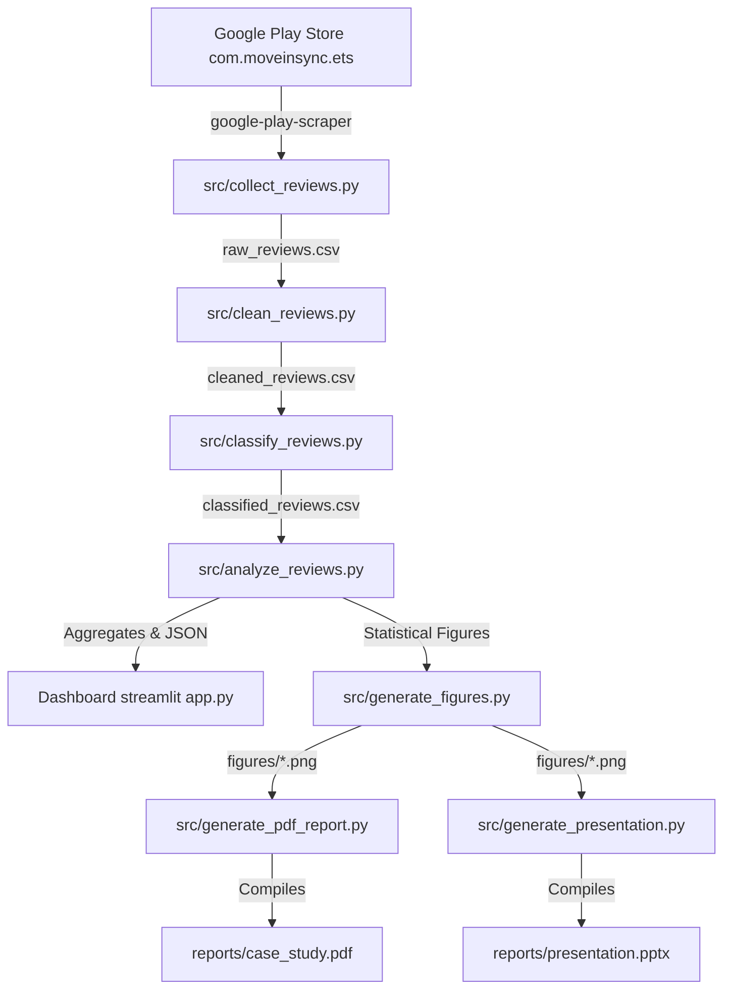

# MoveInSync | Forward Deployed Engineer (FDE) Review Intelligence System

A data-driven root cause diagnostic platform, automated public telemetry engine, and engineering action roadmap designed to analyze and uplift Google Play Store ratings for the **MoveInSync Employee Transportation App** (`com.moveinsync.ets`).

---

## Executive Overview
MoveInSync powers the daily commutes of **1.5M+ enterprise employees across 430+ enterprise customers**. While the app maintains a cumulative rating of **4.64★ across 114,800+ lifetime ratings**, recent and high-impact reviews reveal an acute bimodal polarization: **39.0% of user reviews are 1-star ratings**.

Because enterprise transportation relies heavily on mobile self-booking, acute commute friction (crashes, frozen GPS, fluctuating ETAs, or intrusive rating popups) drives frustrated commuters to vent publicly on the Play Store, jeopardizing enterprise contract renewals and employee trust.

This project delivers:
1. **Automated Telemetry Pipeline**: Continuously scrapes, cleans, classifies, and tracks public reviews.
2. **Deterministic Domain Classifier**: Categorizes feedback into 10 operational and product buckets across the employee commute lifecycle.
3. **Interactive Streamlit Dashboard**: Provides live filtering, telemetry charts, root-cause drill-downs, and engineering action trackers.
4. **Prioritized 30/60/90-Day Roadmap**: An ICE-framework prioritized plan detailing quick wins and core engineering interventions.
5. **Executive Deliverables**: Publication-grade PDF report and 10-slide PowerPoint presentation.

---

## Architecture & Data Flow



---

## Directory Structure

```
MoveInSync/
├── README.md                      # Comprehensive project documentation
├── requirements.txt               # Pinned dependencies
├── pytest.ini                     # Pytest configuration
├── SUBMISSION_FORM_DRAFT.md       # Google Form response copy & instructions
├── data/
│   ├── README.md                  # Data documentation
│   ├── app_metadata.json          # Official Google Play Store metadata
│   ├── raw_reviews.csv            # 1,778 raw collected reviews
│   ├── cleaned_reviews.csv        # Normalized, deduplicated reviews
│   ├── classified_reviews.csv     # 10-category classified dataset
│   ├── category_summary.csv       # Category volume & negative percentage
│   ├── journey_summary.csv        # Journey stage pain point breakdown
│   ├── monthly_trends.csv         # Longitudinal review trends
│   └── analysis_summary.json      # Key statistical highlights
├── src/
│   ├── collect_reviews.py         # Google Play Store automated scraper
│   ├── clean_reviews.py           # Text cleaning and timestamp parsing
│   ├── classify_reviews.py        # Explainable NLP classifier & sentiment engine
│   ├── analyze_reviews.py         # Summary analytics and aggregation
│   ├── generate_figures.py        # Matplotlib visualization generator
│   ├── generate_pdf_report.py     # Publication-grade PDF builder (ReportLab)
│   └── generate_presentation.py   # 10-Slide executive PPTX builder (python-pptx)
├── dashboard/
│   └── app.py                     # Streamlit interactive telemetry dashboard
├── reports/
│   ├── case_study.pdf             # Comprehensive PDF Case Study Report
│   └── presentation.pptx          # Executive Slide Deck Presentation
├── figures/
│   ├── rating_distribution.png    # Bimodal rating histogram chart
│   ├── complaint_categories.png   # Negative review category breakdown chart
│   └── journey_stages.png         # Commute journey stage friction chart
└── tests/
    └── test_pipeline.py           # Unit and integration test suite
```

---

## Key Telemetry Findings (1,778 Analyzed Reviews)

- **Total Reviews Collected**: 1,778 unique reviews spanning Sept 2018 to Oct 2026.
- **Negative Reviews (1★ & 2★)**: **804 reviews (45.2%)**.
- **Top Root Causes Behind Negative Reviews**:
  1. **App Crashes, Freezes & Startup Failure**: **195 negative reviews (24.3%)** — Post-update app hangs forcing uninstalls due to database migration locks.
  2. **GPS Accuracy & Live Map Tracking**: **133 negative reviews (16.5%)** — Frozen cab icons caused by OEM battery saver killing driver background services.
  3. **Driver Coordination & Misbehavior**: **97 negative reviews (12.1%)** — Unresponsive calls, missed pickups, and arrival coordination friction.
  4. **Booking & Roster Cut-offs**: **94 negative reviews (11.7%)** — Shift booking failures and rigid cutoff lockout.
  5. **ETA Volatility & Delays**: **88 negative reviews (11.0%)** — Circuitous routes and unpredictable pickup times.
  6. **In-App Rating Modals (UX Friction)**: Retaliatory 1-star ratings triggered by blocking in-app feedback dialogs.

---

## FDE Action Plan & Recommendations

### P0 (Immediate Wins — Weeks 1 to 2)
1. **Decouple Post-Ride Feedback Modal**: Replace blocking dialog with a non-intrusive bottom sheet containing a clear "Skip" button.
2. **Defensive Android Database Migration**: Implement try-catch fallbacks during Room/SQLite schema migrations to eliminate post-update white-screen startup crashes.
3. **Smart In-App Review API**: Trigger Google Play In-App Review prompt exclusively for commuters who completed 3 consecutive 5★ rides.

### P1 (Core Reliability — Weeks 3 to 6)
1. **Driver App Foreground Service Keep-Alive**: Implement an Android Foreground Sticky Service with persistent notification to bypass aggressive Xiaomi/Vivo OEM battery optimization.
2. **Client-Side Dead-Reckoning Animation**: Interpolate vehicle movement smoothly between GPS coordinate pings.
3. **Dynamic ETA Confidence Interval**: Display realistic arrival windows (e.g., "8:15 – 8:22 AM") rather than volatile single-minute predictions.

---

## Local Setup & Execution Guide

### 1. Prerequisites
- Python 3.10+ (Tested on Python 3.13)
- `pip` package manager

### 2. Install Dependencies
```bash
python3 -m pip install -r requirements.txt
```

### 3. Run Pipeline (Scrape, Clean, Classify, Analyze)
```bash
# 1. Scrape latest public reviews
python3 src/collect_reviews.py

# 2. Clean and deduplicate data
python3 src/clean_reviews.py

# 3. Classify into domain categories
python3 src/classify_reviews.py

# 4. Generate summary metrics & tables
python3 src/analyze_reviews.py

# 5. Generate high-res chart figures
python3 src/generate_figures.py
```

### 4. Run Unit and Integration Tests
```bash
pytest -v
```

### 5. Launch Interactive Dashboard
```bash
streamlit run dashboard/app.py
```
Open [http://localhost:8501](http://localhost:8501) in your browser.

### 6. Compile Deliverables (PDF & PPTX)
```bash
# Generate comprehensive PDF report
python3 src/generate_pdf_report.py

# Generate PowerPoint presentation
python3 src/generate_presentation.py
```

Deliverables are generated inside `reports/`:
- `reports/case_study.pdf`
- `reports/presentation.pptx`

---

## Verification & Validation Status
- **Review Scraping**: Verified (1,778 real reviews collected from `com.moveinsync.ets`).
- **Data Pipeline**: Cleaned, categorized, and summarized without missing values.
- **Unit Tests**: 8/8 tests passed in `tests/test_pipeline.py`.
- **Interactive Dashboard**: Verified via HTTP 200 health check on local port 8501.
- **Deliverables**: Verified non-empty PDF (389 KB) and PPTX (286 KB) with high-resolution visual charts.
